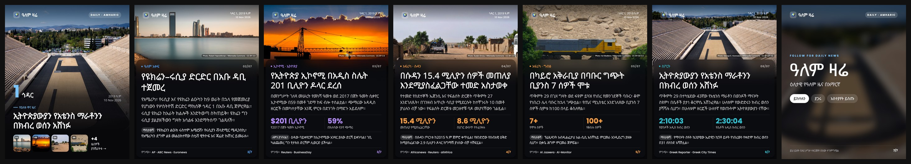
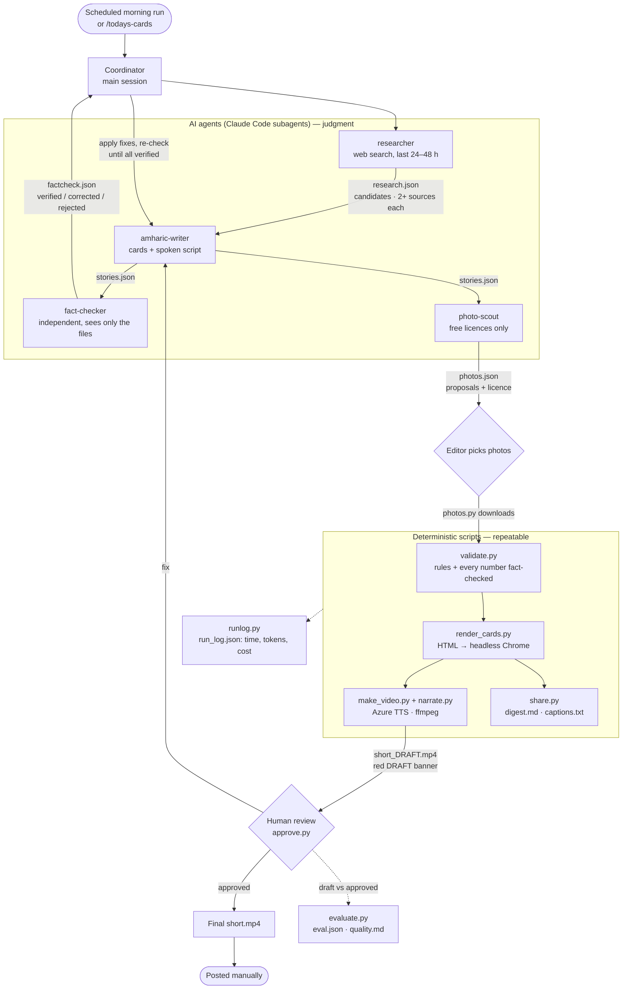
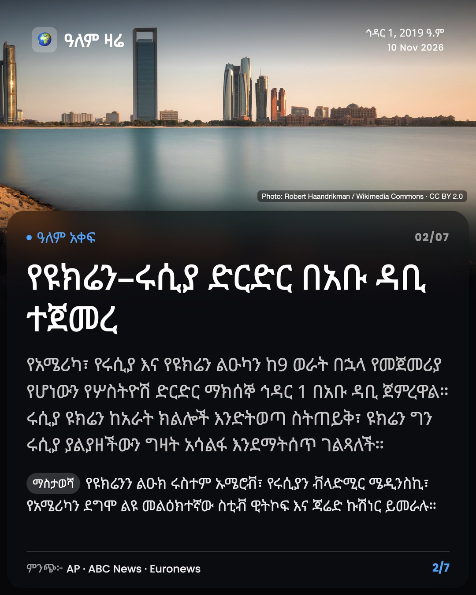
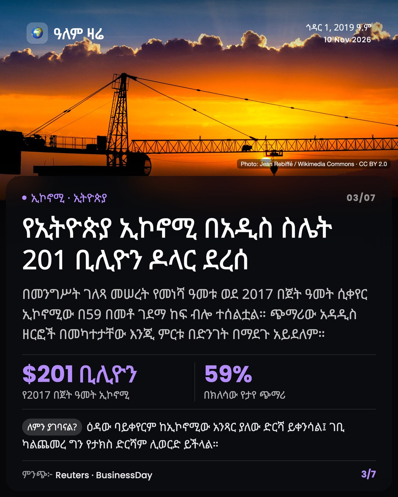
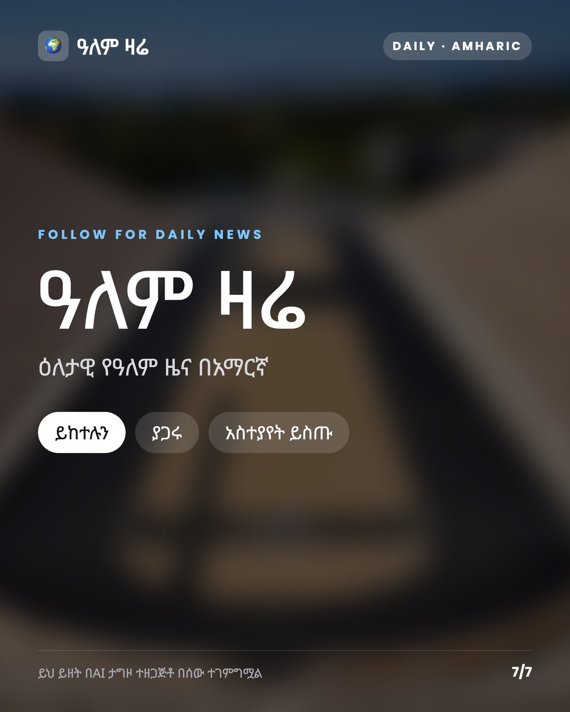

# ዓለም ዛሬ (Alem Zare) — an agentic AI newsroom for Amharic world news

A multi-agent workflow (Claude Code) that turns the day's most important world news into
**Amharic** Instagram carousels and narrated vertical videos (YouTube Shorts / Reels / TikTok).
Specialised AI agents research, write, fact-check and find photos; deterministic scripts check
the rules and produce the media; **a human editor approves every edition before it is published.**



## Why

Fast, reliable world news in Amharic is scarce, especially in short, visual formats for
mobile. This project uses AI agents to do the research, fact-checking and drafting, so a
single native-speaker editor can publish a verified daily edition in minutes instead of hours —
without giving up editorial control.

## Architecture



Every stage writes a **hand-off file** into the day's folder (`editions/YYYY-MM-DD/`), and the next
stage reads only that file. Each step can be checked, re-run or resumed on its own, and the folder
is a complete audit trail of *why* each story and each number is on a card.
Formats: [`docs/pipeline.md`](docs/pipeline.md).

| Stage | Who | Output |
|---|---|---|
| 1. Research | [`researcher`](.claude/agents/researcher.md) agent | `research.json` — 8–12 candidates, 2+ sources from different outlets each, 5 selected with a reason |
| 2. Write | [`amharic-writer`](.claude/agents/amharic-writer.md) agent | `stories.json` — headline, 2-sentence body, stats, note, and a separate script for the voice |
| 3. Fact-check | [`fact-checker`](.claude/agents/fact-checker.md) agent | `factcheck.json` — every number, name, date and attribution → 2+ sources → verdict |
| 4. Photos | [`photo-scout`](.claude/agents/photo-scout.md) agent → editor picks | `photos.json` → [`photos.py`](photos.py) downloads only the picks |
| 5. Rule check | [`validate.py`](validate.py) | blocks rendering on errors (see guardrails below) |
| 6. Cards + video | [`render_cards.py`](render_cards.py), [`make_video.py`](make_video.py), [`narrate.py`](narrate.py) | 7 cards (2160×2700), ~100 s narrated 1080×1920 video |
| 7. Sharing kit | [`share.py`](share.py) | `captions.txt` per platform, `digest.md` reading version |
| 8. Approval | Human editor, [`approve.py`](approve.py) | `status: approved` + fingerprint; only then the final video |
| 9. Measure | [`evaluate.py`](evaluate.py), [`runlog.py`](runlog.py) | what the editor changed; time, tokens, searches, cost |

The whole run is one command, the Claude Code skill
[`/todays-cards`](.claude/skills/todays-cards/SKILL.md). It resumes at the first missing stage, so a
half-finished day can be picked up in a new session. A scheduled morning run does stages 1–4 and stops
at the photo gate with a notification; it never downloads, approves, posts or pushes.

## Design decisions

**1. The LLM decides, scripts execute.**
Agents do what needs judgment — which stories matter, wording, checking claims. Everything that must
be identical every day (rule checks, layout, audio, video, captions) is plain Python. A script either
passes or fails; it does not "mostly" follow a rule.

**2. A human approves everything — enforced in code, not just in the prompt.**
News in a language the model writes less well than English, about politically sensitive regions, needs
a native-speaker editor. Every edition starts as `draft`. `approve.py` needs the editor to type "yes"
and stores a fingerprint of the text and photos; any later edit makes it a draft again. `make_video.py`
only produces the postable `short.mp4` for an approved edition — otherwise it makes `short_DRAFT.mp4`
with a red banner. The agent is instructed never to run `approve.py`. Nothing is posted automatically.

**3. The fact-checker is a separate agent that cannot see the writer's reasoning.**
A model checking its own work tends to agree with itself. The fact-checker gets only the date; it reads
the finished cards and the research file, searches the web again, and gives each claim a verdict:
`verified`, `corrected`, `rejected` or `unclear`. The coordinator fixes the cards and re-runs the check
until everything is verified. `validate.py` then confirms that **every number on a card** is covered by a
verified claim and warns if the text changed after the check.

**4. Hand-off files instead of one long conversation.**
Each agent starts fresh with just the date and reads the previous stage's file. This keeps context small
(cheaper, fewer mix-ups), makes failures local, and lets any stage be re-run alone.

**5. Editorial guardrails written as checks.**
- No direct quotes on cards or in narration — a translated quote is no longer the speaker's exact words,
  so claims are always reported speech with the speaker named, and never read as fact.
- Neutral wording, sources credited on every card, an AI-disclosure line on the final card.
- Headline ≤ ~8 words, 2-sentence body, 0–2 stats (only for a strong number), no flag emoji.
- Correct Ethiopian-calendar date, computed by [`etdate.py`](etdate.py) — never by the model.

**6. Licensing by design.**
Only freely licensed photos (Wikimedia Commons CC0 / CC BY / CC BY-SA, US-government public domain,
Unsplash/Pexels for generic scenes). `validate.py` rejects NC and ND licences (cards are cropped and
tone-adjusted). The photo-scout reads the licence on the file page; the editor approves each photo before
download. Music is royalty-free and not Content ID registered.

**7. Separate text for the ear.**
Each story has a `speech` version with numbers, dates and acronyms written out in Amharic words, so the
neural voice reads it naturally. `validate.py` fails if any Latin letter, digit or symbol is left in it.

**8. Measure the AI, not just the output.**
`evaluate.py` saves the AI's draft at hand-over and, on approval, compares it with what the editor
published: which fields changed, share of words changed, and the kind of fix (punctuation, numbers,
small wording, rewording, rewrite, story replaced). `runlog.py` records time, tokens per model, web
searches, subagents, Azure voice characters and an estimated cost for each edition.

## Results

<!-- Updated from reports/quality.md (python3 evaluate.py --summary) and run_log.json -->
Measurement starts with the first edition made with the full pipeline (from 11 Nov 2026).
The weekly table lives in [`reports/quality.md`](reports/quality.md) once the first edition is approved:

| Metric | Source | Value |
|---|---|---|
| Editions approved | `reports/quality.md` | *pending* |
| Headlines / bodies changed by the editor | `eval.json` | *pending* |
| Most common kind of fix | `eval.json` | *pending* |
| Claims fact-checked per edition (and % needing a fix) | `factcheck.json` | *pending* |
| Time and cost per edition | `run_log.json` | *pending* |

Sample video: *link coming (YouTube Shorts)*.

<p>
  
  
  
  
</p>

## Tech stack

Python · Claude Code (skills, subagents, scheduled tasks) · Playwright / headless Chrome · HTML/CSS ·
Pillow · Azure AI Speech (neural TTS) · ffmpeg · Git/GitHub

## How it was built

Step by step, with every decision logged in [`PROGRESS.md`](PROGRESS.md): version control → rules as
code → pipeline stages with hand-off files → human approval gate → draft-quality evaluation → run log →
skill + subagents + scheduled run → sharing kit → this write-up. The agent's operating rules are in
[`CLAUDE.md`](CLAUDE.md). Design options and mock-ups chosen from are in [`docs/`](docs/).

## Licence

Code: MIT (see [`LICENSE`](LICENSE)). Photos keep their own licences (see each edition's
`credits.md`). Edition texts © the project owner.

---

# Usage

## Folder layout
```
amharic-news/
├── .claude/
│   ├── skills/todays-cards/  the daily workflow as one command
│   └── agents/               researcher, amharic-writer, fact-checker, photo-scout
├── validate.py          checks a day's files against the rules (runs before every render)
├── render_cards.py      makes the cards (+ runs share.py)
├── make_video.py        makes the vertical video from the cards
├── narrate.py           Amharic AI narration (Azure voice; key in .env)
├── approve.py           the editor's approval (only a human runs it)
├── evaluate.py          draft vs approved → eval.json, reports/quality.md
├── runlog.py            time / tokens / cost per edition → run_log.json
├── share.py             captions.txt + digest.md
├── photos.py            list photo proposals, download the editor's picks
├── etdate.py            Ethiopian calendar date
├── card.css             the card style — edit this to restyle
├── music/               royalty-free tracks list (tracks.json) + licences
├── editions/
│   └── 2026-11-10/      one folder per day
│       ├── research.json  stories.json  factcheck.json  photos.json
│       ├── stories.draft.json  eval.json  run_log.json
│       ├── images/      that day's photos
│       ├── cards/       01_cover.jpg … 07_follow.jpg (generated)
│       ├── video/       short_DRAFT.mp4 / short.mp4 (generated)
│       └── credits.md  digest.md  captions.txt (generated)
├── docs/                pipeline formats, style options and mock-ups
└── showcase/            sample cards for this README
```

## One-time setup (Mac)
```bash
cd ~/Documents/Claude/amharic-news
python3 -m venv .venv && source .venv/bin/activate
pip install -r requirements.txt
python -m playwright install chromium   # only needed if Google Chrome isn't installed
cp .env.example .env                    # then add your Azure Speech key and region
```
Recommended fonts: **Noto Sans Ethiopic** and **Poppins** from fonts.google.com.
Without them, the Mac's built-in Amharic font "Kefa" is used.

## Make a day's edition
With Claude Code (in this folder, run `claude`):
```
/todays-cards 2026-11-11
```
It researches, writes, fact-checks and proposes photos, then waits for you to pick photos;
after that it renders the cards and a draft video and hands over for review.

Then, as the editor:
1. Check `editions/DATE/cards/`, `video/short_DRAFT.mp4`, `captions.txt` (and `digest.md` to read up).
2. Approve: `python3 approve.py DATE` (type `yes`).
3. Final video: `python3 make_video.py DATE` → `video/short.mp4`.
4. Post manually and switch on the platform's "AI-generated" label (the voice is synthetic).

By hand: `python3 render_cards.py --new DATE` starts a day; `python3 validate.py DATE` checks it;
`python3 render_cards.py DATE` renders (prints `OVERFLOW!` if text doesn't fit);
`python3 make_video.py DATE [--voice ameha|mekdes] [--no-voice] [--silent]` makes the video.

Reports: `python3 evaluate.py --summary` → `reports/quality.md`; `python3 runlog.py DATE` → `run_log.json`.

## Cover story
The cover shows one "lead" story's photo and headline. Choose it in `stories.json` with
`"lead": 4` (the 4th story). Without it, the first story with a photo is used.

## Photos
Every story should have one; a story without a photo gets a colour block with its emoji instead.
```json
"image": {
  "file": "images/ebola.jpg",
  "credit": "Photo: Name / Wikimedia Commons · CC BY 4.0",
  "source": "https://commons.wikimedia.org/wiki/File:...",
  "position": "center 30%"
}
```
`credit` is printed on the card; `source` goes into `credits.md`; `position` (optional)
chooses which part of the photo to keep when cropping.

Only use photos you are allowed to use:
- OK: Wikimedia Commons (CC0 / CC BY / CC BY-SA — not NC or ND), US-government public-domain
  photos (CDC, NASA, State Dept…), Unsplash / Pexels (generic scenes only, not presented as
  the event itself).
- Never: Reuters / AP / AFP / Getty / BBC photos, TV or site screenshots, or realistic
  AI images made to look like the real event.
