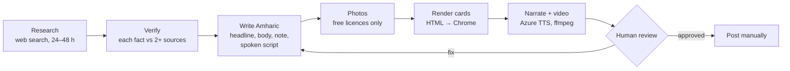

# ዓለም ዛሬ (Alem Zare) — an agentic AI newsroom for Amharic world news

An AI-agent workflow that turns the day's most important world news into **Amharic** Instagram
carousels and narrated vertical videos (YouTube Shorts / Reels / TikTok), with a human editor
approving everything before it is published.


## Why

Fast, reliable world news in Amharic is scarce, especially in short, visual formats for
mobile. This project uses an AI agent to do the research, fact-checking and drafting, so a
single native-speaker editor can publish a verified daily edition in minutes instead of hours.

## How it works



| Stage | Who does it | How |
|---|---|---|
| Research, verification, Amharic writing, photo search | AI agent (Claude Code) | Follows the operating rules in [`CLAUDE.md`](CLAUDE.md) |
| Card rendering | Deterministic script | [`render_cards.py`](render_cards.py) — HTML/CSS → headless Chrome (Playwright), overflow detection |
| Narration | Deterministic script | [`narrate.py`](narrate.py) — Azure neural TTS with a separate, ear-friendly script per story |
| Video | Deterministic script | [`make_video.py`](make_video.py) — photo-only zoom on layered cards, crossfades, music bed |
| Review and publishing | Human editor | Every card and the narration text is reviewed; posting is manual |

### Design decisions

- **The LLM decides, scripts execute.** The agent handles judgment (which stories, wording,
  fact-checking); everything that must be repeatable (layout, audio, video) is plain code.
- **Human in the loop.** Nothing is published automatically. AI text is always a draft.
- **Editorial guardrails written as agent rules:** neutral wording, no direct quotes (only
  attributed reported speech, so a translated claim never reads as fact), every fact checked
  against 2+ reputable sources, sources credited on each card, an AI-disclosure line on the
  final card.
- **Licensing by design:** only freely licensed photos (Wikimedia Commons CC0/BY/BY-SA,
  US-government public domain), credited on the card and in `credits.md`; only royalty-free
  music that is not Content ID registered.
- **Separate text for the ear.** Each story has a `speech` version with numbers and acronyms
  in words, so the AI voice reads it naturally.

## Tech stack

Python · Claude Code (agent) · Playwright / headless Chrome · HTML/CSS · Pillow ·
Azure AI Speech (neural TTS) · ffmpeg

## Roadmap

Work in progress, tracked step by step in [`PROGRESS.md`](PROGRESS.md):
validation of editorial rules in code, a separate fact-checker agent with saved evidence,
an approval gate, quality measurement (AI draft vs approved text), run logs, and a
scheduled morning draft.

## Licence

Code: MIT (see [`LICENSE`](LICENSE)). Photos keep their own licences (see each edition's
`credits.md`). Edition texts © the project owner.

---

# Usage

## Folder layout
```
amharic-news/
├── render_cards.py      makes the cards
├── make_video.py        makes the vertical video (Shorts / Reels / TikTok) from the cards
├── narrate.py           Amharic AI narration for the video (Azure voice; key in .env)
├── .env                 your Azure key — private, never share (copy .env.example)
├── card.css             the card style (colours, sizes, fonts) — edit this to restyle
├── music/               royalty-free background tracks + tracks.json (licences)
├── editions/
│   └── 2026-11-10/      one folder per day
│       ├── stories.json all text for the day (+ optional photo per story)
│       ├── images/      that day's photos
│       ├── cards/       01_cover.jpg … 07_follow.jpg (2160×2700) — post these
│       ├── video/       short.mp4 — vertical video (written by make_video.py)
│       └── credits.md   news sources + photo credits/links (written automatically)
├── docs/                style options and mock-ups we chose from (design process)
└── showcase/            sample cards for this README
```

## One-time setup (Mac)
```bash
cd ~/Documents/Claude/amharic-news
python3 -m venv .venv && source .venv/bin/activate
pip install -r requirements.txt
python -m playwright install chromium   # only needed if Google Chrome isn't installed
```
Recommended fonts (double-click to install): **Noto Sans Ethiopic** and **Poppins**
from fonts.google.com. Without them, the Mac's built-in Amharic font "Kefa" is used.

## Make a day's cards
1. Start the day: `python3 render_cards.py --new 2026-11-11`
   (creates `editions/2026-11-11/`, copying the last stories.json as a starting point),
   or just ask Claude Code: "make today's cards".
2. Edit `editions/2026-11-11/stories.json`; put photos in its `images/` folder.
3. Render: `python3 render_cards.py` (latest edition) or `python3 render_cards.py 2026-11-11`.
   It prints `OVERFLOW!` if any card's text is too long.
4. Review `editions/2026-11-11/cards/`, then post.
5. Video for YouTube Shorts / Instagram Reels / TikTok: `python3 make_video.py`
   (or `python3 make_video.py 2026-11-11`) → `editions/2026-11-11/video/short.mp4`
   (about 100 s, 1080×1920) with an Amharic AI voice reading each card and quiet background music.
   Voice: `--voice ameha` (male, default) or `--voice mekdes` (female); `--no-voice` for music only;
   `--silent` for no music. What the voice reads is in `editions/2026-11-11/audio/narration.txt`.
   The voice needs the Azure key in the `.env` file (keep it private).
   When posting, switch on the app's "AI-generated" label (the voice is synthetic).
   Tracks are in `music/`; see `music/README.md` to add more.
   If the music needs attribution, copy the line from `credits.md` into the caption.

## Cover story
The cover shows one "lead" story's photo and headline. Choose it in `stories.json` with
`"lead": 4` (the 4th story). Without it, the first story with a photo is used.

## Photos
Every story should have one (the style is built around photos); a story without a photo gets a
colour block with its emoji instead.
Add to a story in `stories.json`:
```json
"image": {
  "file": "images/ebola.jpg",
  "credit": "Photo: Name / Wikimedia Commons · CC BY 4.0",
  "source": "https://commons.wikimedia.org/wiki/File:...",
  "position": "center 30%"
}
```
`credit` is printed on the card; `source` goes into `credits.md`; `position` (optional)
chooses which part of the photo to keep when cropping. Stories without `image` use the
emoji layout.

Only use photos you are allowed to use:
- OK: Wikimedia Commons (CC0 / CC BY / CC BY-SA — not "NC"), US-government public-domain
  photos (CDC, NASA, State Dept…), Unsplash / Pexels (generic scenes only, not presented as
  the event itself).
- Check terms first: official handout photos (UN, WHO, governments).
- Never: Reuters / AP / AFP / Getty / BBC photos, TV or site screenshots, or realistic
  AI images made to look like the real event.

## Using Claude Code
Open a terminal in this folder and run `claude`. It reads `CLAUDE.md` for the
project rules and daily workflow.
